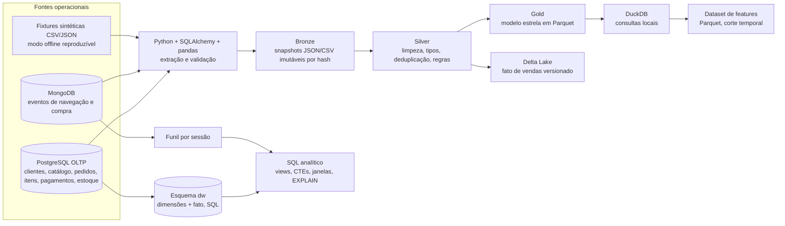

# Arquitetura e organização — VarejoMix

## Arquitetura de referência



**Papel de cada camada.** PostgreSQL protege a consistência transacional por chaves, restrições e transações. MongoDB armazena eventos autocontidos e variáveis. O pipeline Python extrai uma fonte real quando as variáveis de conexão estão configuradas; caso contrário, executa o mesmo fluxo usando fixtures locais declaradas como sintéticas. Bronze preserva snapshots de entrada. Silver converte tipos, elimina duplicatas por chave natural e separa registros inválidos. Gold publica arquivos Parquet para consumo analítico. Uma tabela de vendas Gold é gravada em Delta Lake para demonstrar snapshots versionados e reprocessamento. DuckDB consulta Parquet sem exigir servidor analítico.

**Delimitação operacional.** Docker Compose define PostgreSQL e MongoDB com versões fixadas e volumes locais. Nesta sandbox Docker não está instalado; os scripts podem ser desenvolvidos e executados sobre fixtures, e o SQL é preparado para PostgreSQL. A execução de integração de cada serviço é registrada em `evidencias/STATUS_EXECUCAO.md`, sem confundir fixture JSON com uma sessão MongoDB real. O relatório separa recursos implementados dos que dependem da inicialização do Compose.

## Esquema estrela e granularidade

`dw.fact_sales` contém **uma linha por item de pedido**. Chave natural/idempotente: `order_item_id`. As dimensões são cliente, produto, data, loja e canal. Receita bruta é preço unitário × quantidade. Desconto é o desconto registrado no item. Receita líquida subtrai desconto e o valor líquido correspondente a quantidades devolvidas. Pedidos cancelados ou integralmente estornados não compõem as vendas. Margem estimada = receita líquida − custo unitário × quantidade não devolvida. Não é margem contábil; frete, impostos, taxas e custo operacional não estão no conjunto sintético.

O funil é medido por sessão e janela explícita: sessões com `page_view` são a base; cada etapa é a quantidade de sessões distintas com o evento correspondente no período. Coorte = mês da primeira compra; intervalo entre compras é calculado com `LAG` sobre pedidos concluídos.

## Árvore de arquivos

```text
VarejoMix/
├── README.md, docker-compose.yml, .env.example, requirements.txt
├── sql/                  # DDL transacional, carga, estrela, consultas, índices e planos
├── nosql/                # JSON Schema, eventos amostrais, modelagem e carga/indexação MongoDB
├── python/               # geração sintética, extração, transformação e features
├── lakehouse/            # pipeline Bronze/Silver/Gold, Delta, DuckDB
├── data/source/          # fixtures sintéticas versionáveis
├── data/bronze|silver|gold/  # saídas locais reproduzíveis (geradas)
├── tests/                # integridade, eventos, métricas, pipeline e features
├── evidencias/           # logs de testes, planos reais e status da execução
├── docs/                 # arquitetura, dicionário, caso de mercado e pitch
└── relatorio/            # fontes Typst e PDF técnico
```

## Trade-offs

- PostgreSQL e MongoDB são serviços em contêineres opcionais para manter o início simples; as fixtures cobrem a execução offline e os contratos de dados.
- Delta Lake é implementado com `deltalake` (delta-rs), evitando obrigar um cluster Spark num dataset acadêmico pequeno. A consulta a versões é feita pela API `DeltaTable`; o histórico expira se os arquivos/logs forem removidos.
- Arquivos são particionados por mês (pedidos) ou data do evento, evitando partições por cliente/produto. Com poucos dados pode haver um arquivo por partição; não se alega benefício de desempenho nesse volume.
- Os dados são sintéticos, determinísticos e não representam operação real nem desempenho de produção.
